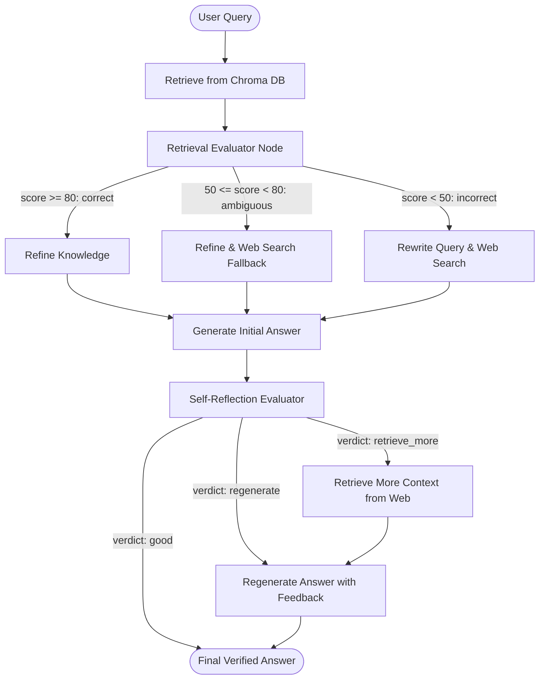

# Self-Correcting RAG (Retrieval-Augmented Generation)

[](https://github.com/epiGnokso/Self-Correcting-RAG)
[](https://www.python.org/)
[](https://fastapi.tiangolo.com/)
[](https://langchain-ai.github.io/langgraph/)
[](https://react.dev/)
[](https://vitejs.dev/)
[](https://www.docker.com/)
[](./LICENSE)

An intelligent, autonomous **Self-Corrective Retrieval-Augmented Generation (Self-RAG / CRAG)** platform. Unlike traditional static RAG pipelines that blindly trust retrieved context and produce hallucinations or incomplete answers, this system evaluates document relevance, refines knowledge passages, falls back to multi-provider web search when information is missing or ambiguous, and performs self-reflection with automated answer regeneration.

Developed as a Major Project under the supervision of **Dr. Gurpreet Singh**, submitted in partial fulfillment of the requirements for the degree of **Bachelor of Technology (Computer Science & Engineering)** at **Amity University Punjab, India**.

---

## Architecture & Workflow

The core reasoning engine is built using **LangGraph** as a cyclic state machine:



### Self-Correction Stages

1. **Adaptive Retrieval**: Dense semantic search over local vector stores using NVIDIA's `nemotron-3-embed-1b` embeddings.
2. **Retrieval Grading**: A structured evaluator assigns a confidence score ($0-100$) and categorizes retrieval:
   - **Correct** ($\ge 80$): Context is sufficient and accurate.
   - **Ambiguous** ($50-79$): Context is partially relevant; triggers sentence-level filtering and Tavily/DuckDuckGo web augmentation.
   - **Incorrect** ($< 50$): Context is irrelevant; rewrites the search query and searches the web.
3. **Knowledge Refinement**: Removes irrelevant sentences and distills high-value context before generation.
4. **Answer Generation**: Synthesizes a grounded answer constrained strictly to verified context.
5. **Self-Reflection & Hallucination Detection**: Evaluates answer quality against context:
   - **`good`**: Grounded and answers the question completely.
   - **`regenerate`**: Identifies structural or stylistic gaps and regenerates the answer with explicit feedback.
   - **`retrieve_more`**: Detects knowledge gaps, retrieves additional external evidence, and regenerates.

---

## Features

- **End-to-End Self-Corrective RAG**: Autonomous evaluation loops prevent hallucinations and retrieval failures.
- **Dynamic Document Ingestion**: Upload PDFs or text files via drag-and-drop; automatic chunking and vectorstore indexing with Chroma DB.
- **Multi-Provider Search Fallback**: Seamless fallback between Tavily, DuckDuckGo, Zenserp, and Google Serper.
- **Interactive Full-Stack Interface**:
  - Dark and Light glassmorphic themes with smooth view transitions.
  - Interactive **Self-Correction Trace Accordion** displaying decision routes, grading scores, and reflection feedback.
  - Hoverable citation pills with snippet popovers and source links.
  - Knowledge Base management drawer for adding and deleting reference documents.
- **Production-Ready Deployment**:
  - Ready-to-use Docker and Docker Compose setup with Nginx reverse proxy.
  - Unified single-port hosting option (FastAPI serving prebuilt React assets).

---

## Repository Structure

```
Self-Correcting-RAG/
├── README.md                  # Project documentation
├── LICENSE                    # Project license
├── synopsis/                  # Project academic synopsis & LaTeX source
├── report/                    # Comprehensive project report
├── planning/                  # Project planning & architectural artifacts
└── code/
    ├── compose.yml            # Docker Compose orchestration
    ├── backend/
    │   ├── Dockerfile         # Backend container definition
    │   ├── server.py          # FastAPI REST API & LangGraph orchestration
    │   ├── state.py           # TypedDict RAG state definition
    │   ├── llm.py             # LLM & Embedding endpoint configurations
    │   ├── retrieve.py        # Vector retrieval logic
    │   ├── retrieval_evaluator.py # Document evaluation & routing
    │   ├── refine.py          # Knowledge distillation & query rewriting
    │   ├── generate.py        # Contextual answer synthesis
    │   ├── reflect.py         # Answer critique & hallucination checks
    │   ├── retrieve_more.py   # Secondary web retrieval
    │   ├── regenerate.py      # Targeted answer regeneration
    │   ├── search_tool.py     # Web search provider integration
    │   ├── chroma_db/         # Persistent Chroma vector store
    │   └── requirements.txt   # Pinned Python dependencies
    └── frontend/
        ├── Dockerfile         # Multi-stage frontend container definition
        ├── nginx.conf         # Production Nginx reverse-proxy
        ├── vite.config.js     # Vite configuration with API proxy
        ├── package.json       # Node.js dependencies & scripts
        └── src/
            ├── App.jsx        # Main application component & API hooks
            ├── components/    # ChatContainer, MessageBubble, DocumentPanel, etc.
            └── styles/        # Glassmorphic themes & responsive CSS
```

---

## Getting Started

### Prerequisites

- [Docker & Docker Compose](https://docs.docker.com/get-docker/) (for containerized run)
  *or*
- [Python 3.12+](https://www.python.org/downloads/) + [uv](https://github.com/astral-sh/uv) / `pip`
- [Node.js 20+](https://nodejs.org/) & `npm` (for local frontend development)

### Environment Configuration

Create a `.env` file in `code/backend/.env`:

```env
# NVIDIA NIM API Key (used for embeddings)
NVIDIA_API_KEY=your_nvidia_api_key

# OpenRouter / OpenAI Key (used for LLM inference)
OPENAI_API_KEY=your_openrouter_api_key

# Web Search API Keys (at least one is required for web fallback)
TAVILY_API_KEY=your_tavily_api_key
ZENSERP_API_KEY=your_zenserp_api_key       # optional
SERPER_API_KEY=your_serper_api_key         # optional
```

---

## Running the Application

### Option 1: Docker Compose (Recommended)

From the `code/` directory:

```bash
cd code
docker compose up --build -d
```

- **Frontend UI**: [http://localhost:5173](http://localhost:5173)
- **Backend API & Swagger Docs**: [http://localhost:8000/docs](http://localhost:8000/docs)
- **Health Check**: [http://localhost:8000/api/health](http://localhost:8000/api/health)

To stop the containers:
```bash
docker compose down
```

---

### Option 2: Local Development

#### 1. Backend Setup
```bash
cd code/backend

# Using uv (fastest):
uv venv
source .venv/bin/activate
uv pip install -r requirements.txt

# Start FastAPI server with live reload:
python -m uvicorn server:app --host 0.0.0.0 --port 8000 --reload
```

#### 2. Frontend Setup
```bash
cd code/frontend

# Install dependencies
npm install

# Start Vite dev server (proxies /api to http://localhost:8000)
npm run dev
```

Visit [http://localhost:5173](http://localhost:5173) to interact with the application.

---

### Option 3: Unified Single-Port Production Mode

FastAPI is configured to automatically serve the pre-built React application from `frontend/dist`:

```bash
# 1. Build frontend assets
cd code/frontend
npm run build

# 2. Start the unified server
cd ../backend
python server.py
```

Both the web interface and API endpoints will be accessible at [http://localhost:8000](http://localhost:8000).

---

## API Reference

### `POST /api/query`
Executes the Self-Corrective RAG pipeline.

**Request Body:**
```json
{
  "question": "What is Self-RAG and how does it prevent hallucinations?"
}
```

**Response:**
```json
{
  "answer": "Self-RAG trains an arbitrary language model to adaptively retrieve, generate, and critique passages using specialized reflection tokens...",
  "sources": [
    {
      "name": "2401.15884v3.pdf",
      "type": "document",
      "page": 1,
      "snippet": "Self-RAG improves an LLM's quality and factuality through adaptive retrieval..."
    }
  ],
  "evaluation": {
    "score": 85,
    "verdict": "correct",
    "reasoning": "Retrieved documents provide a direct definition and architectural breakdown."
  },
  "reflection": {
    "verdict": "good",
    "grounded": true,
    "hallucination": false,
    "confidence": 95,
    "reasoning": "Answer is fully grounded in the provided context without extrapolation."
  },
  "steps": [
    "1. Initialized Self-Corrective RAG workflow.",
    "2. Retrieved 5 document chunks from Chroma DB.",
    "3. Retrieval Evaluator score: 85/100 -> Route: 'correct'.",
    "4. Knowledge Refinement: Filtered irrelevant sentences.",
    "5. Generated contextual answer using LLM.",
    "6. Self-Reflection: Verdict 'good' | Grounded: True | Hallucination: False.",
    "7. Self-correction complete. Final answer accepted."
  ]
}
```

### `GET /api/documents`
Lists all documents currently indexed in the knowledge base.

### `POST /api/upload`
Uploads and indexes one or more PDF or text files into the Chroma vector store.

### `DELETE /api/documents/{doc_id}`
Deletes a document and its corresponding vector embeddings from Chroma DB.

### `GET /api/health`
Returns system status, active document count, and vector database stats.

---

## Academic Details & Contributors

This project was conceived and implemented as a Major Project for the Bachelor of Technology degree in Computer Science & Engineering.

### Student Researchers
- **Gurmukh Singh** (Enrollment: `A25305223008`) — [GitHub](https://github.com/epiGnokso)
- **Manas Khanna** (Enrollment: `A25305223002`) — [GitHub](https://github.com/manas15khanna)
- **Arshleen Kaur** (Enrollment: `A25305223141`) — [GitHub](https://github.com/arshleen-kaur)

### Project Guide
- **Dr. Gurpreet Singh**, Assistant Professor, Department of Computer Science & Engineering

### Institution
- **Amity School of Engineering & Technology (ASET)**  
  Amity University Punjab, Mohali, India

---

## References

1. Asai, A., et al. (2023). *Self-RAG: Learning to Retrieve, Generate, and Critique through Self-Reflection*. [arXiv:2310.11511](https://arxiv.org/abs/2310.11511).
2. Yan, S. Q., et al. (2024). *Corrective Retrieval Augmented Generation (CRAG)*. [arXiv:2401.15884](https://arxiv.org/abs/2401.15884).
3. LangGraph: *Building stateful, multi-actor applications with LLMs*. [LangChain Docs](https://langchain-ai.github.io/langgraph/).
